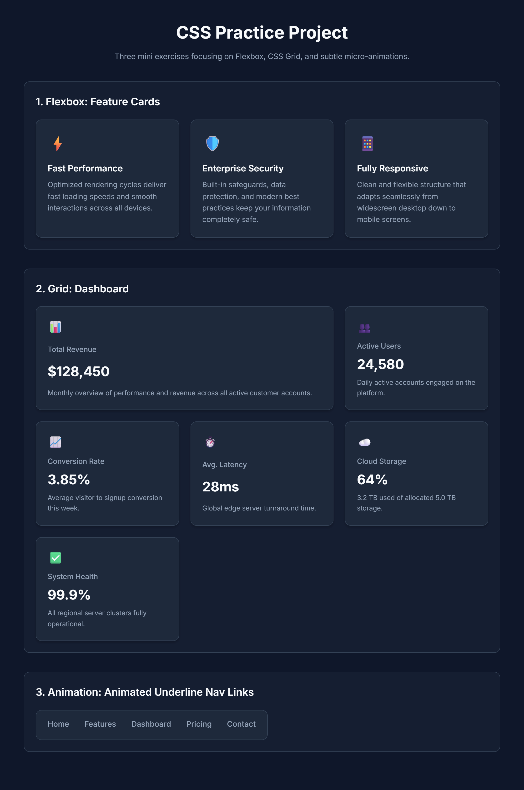
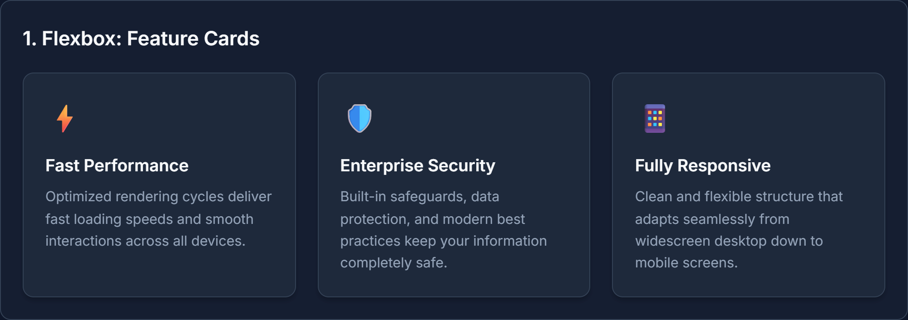
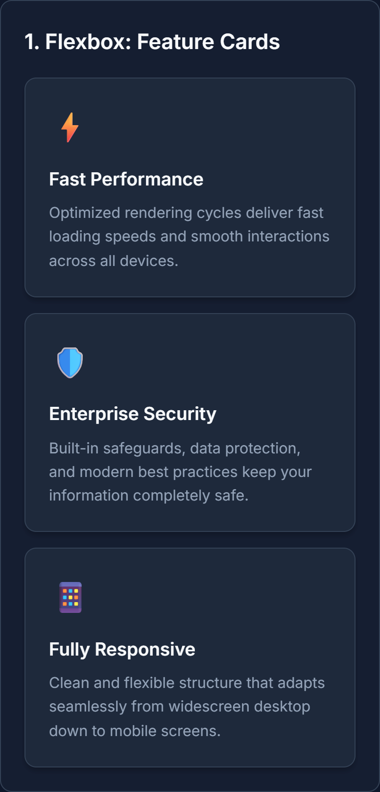
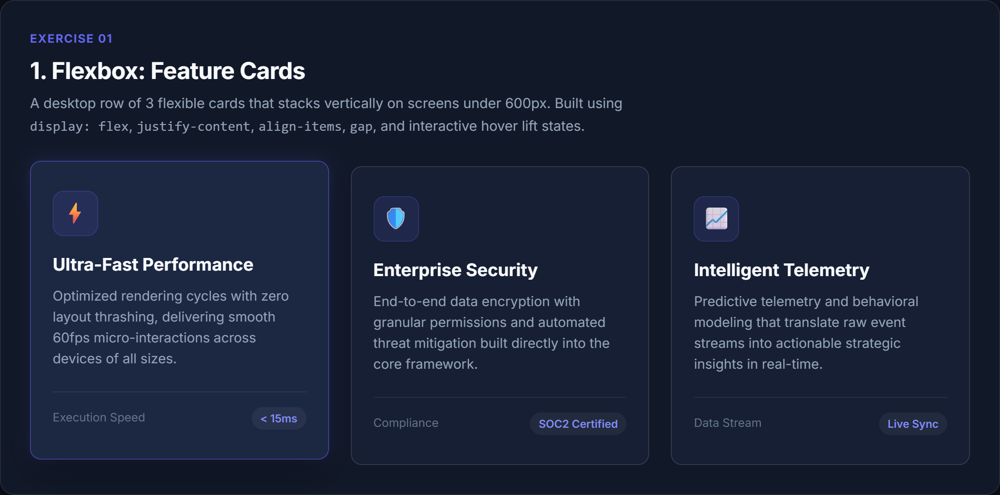
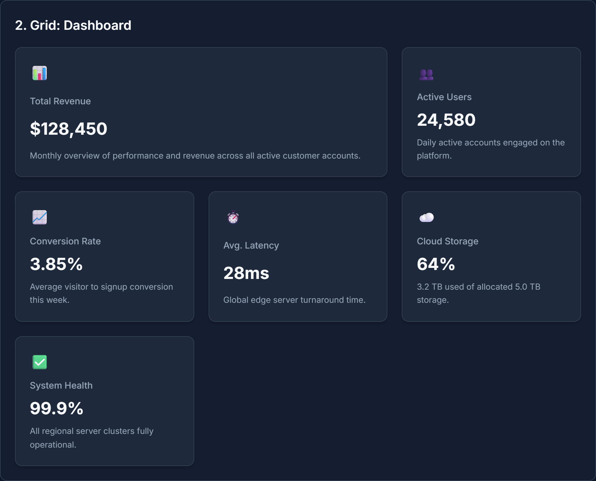
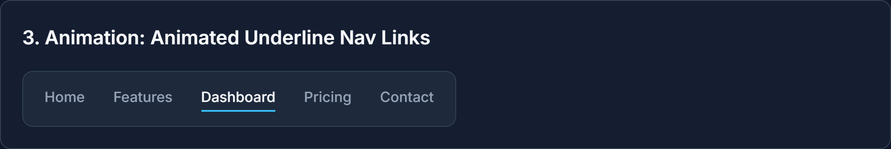

# 🎨 CSS Practice Project: Modern Layouts & Micro-Animations

[](https://developer.mozilla.org/en-US/docs/Web/HTML)
[](https://developer.mozilla.org/en-US/docs/Web/CSS)
[](#)
[](LICENSE)

A clean, responsive, and framework-free front-end practice project developed for **Weintern Assignment-3**. This project demonstrates mastery over modern CSS layout systems (**Flexbox** and **CSS Grid**) and smooth **CSS micro-interactions** using semantic HTML5 and vanilla CSS.

---

## 📑 Table of Contents

- [🎯 Objective](#-objective)
- [💻 Tech Stack](#-tech-stack)
- [✨ Features Implemented](#-features-implemented)
  - [1. Flexbox: Feature Cards](#1-flexbox-feature-cards)
  - [2. Grid: Analytics Dashboard](#2-grid-analytics-dashboard)
  - [3. Animation: Animated Underline Navigation & Page Fade-In](#3-animation-animated-underline-navigation--page-fade-in)
- [📁 Folder Structure](#-folder-structure)
- [🚀 Setup or Run Instructions](#-setup-or-run-instructions)
  - [Quick Start](#quick-start)
  - [Using a Local Development Server](#using-a-local-development-server)
- [🌐 Live Project Link](#-live-project-link)
- [📸 Screenshots](#-screenshots)
- [👤 Author Details](#-author-details)

---

## 🎯 Objective

The primary goals of this project are:
1. **Master Modern CSS Layouts**: Build practical layouts using **Flexbox** for one-dimensional flexible component flows and **CSS Grid** for two-dimensional dashboard layouts without external UI frameworks.
2. **Implement Responsive Design**: Ensure seamless adaptability across desktop (`>= 900px`), tablet (`601px - 899px`), and mobile (`<= 600px`) viewports using clean media queries.
3. **Craft Engaging Micro-Interactions**: Implement lightweight, GPU-accelerated CSS animations (`transform`, `opacity`) such as hover lift states, sliding underline navigation effects, and page entrance animations.
4. **Follow Best Practices**: Maintain modular and organized stylesheets (`flexbox.css`, `grid.css`, `animation.css`), utilize **CSS Custom Properties (Variables)** for design tokens, and write accessible, semantic HTML5 markup.

---

## 💻 Tech Stack

| Technology | Role & Usage |
| :--- | :--- |
| **HTML5** | Semantic structure (`<header>`, `<section>`, `<nav>`, accessible elements, viewport meta tags) |
| **CSS3 (Vanilla)** | Layouts (Flexbox & CSS Grid), Custom Properties (`:root` variables), Transitions, Keyframe Animations |
| **Google Fonts** | Typography using the modern `Inter` sans-serif font family |

---

## ✨ Features Implemented

### 1. Flexbox: Feature Cards
- **Equal-Width Flexibility**: Uses `flex: 1 1 0;` on `.feature-card` to ensure all cards maintain equal dimensions regardless of text length.
- **Alignment & Spacing**: Parent `.feature-cards` utilizes `display: flex;`, `justify-content: space-between;`, `align-items: stretch;`, and CSS variable gap spacing (`gap: var(--gap)`).
- **Interactive Lift Hover**: Smooth elevation with `transform: translateY(-6px);`, dynamic shadow expansion (`--shadow-lift`), and accent border transition (`border-color: var(--accent-color)`).
- **Mobile Responsive Stacking**: Automatically stacks cards vertically (`flex-direction: column;`) on screens narrower than `600px`.

### 2. Grid: Analytics Dashboard
- **Auto-Fit Responsive Grid**: Implements `grid-template-columns: repeat(auto-fit, minmax(240px, 1fr));` with equal spacing across all cards.
- **Consistent Visual Hierarchy**: Consistent design tokens applied across 6 dashboard metric cards (matching border-radius, background, border, and shadows).
- **Featured Multi-Column Card**: `.featured-item` spans across 2 columns on desktop viewports (`grid-column: span 2;`).
- **Responsive Multi-Breakpoint Flow**:
  - **Desktop (≥ 900px)**: 3-column layout with 1 item spanning 2 columns.
  - **Tablet (601px - 899px)**: 2-column layout with the featured item adapting across 2 columns.
  - **Mobile (≤ 600px)**: 1-column layout where each item fills the full width.

### 3. Animation: Animated Underline Navigation & Page Fade-In
- **Sliding Underline Micro-Interaction**:
  - Styled navigation link items with `position: relative;`.
  - Built using the `::after` pseudo-element with `transform: scaleX(0);` and `transform-origin: left;`.
  - On `:hover`, scales to `transform: scaleX(1);` over `0.3s ease`, creating a fluid left-to-right underline slide.
- **Page Entrance Transition**: Keyframe animation `@keyframes fadeIn` fades in and lifts the content (`translateY(8px) -> translateY(0)`) smoothly on page load.
- **Responsive Navigation**: Navbar wraps items (`flex-wrap: wrap`) and centers links on mobile screens.

---

## 📁 Folder Structure

```text
Weintern Assignment-3/
├── index.html                   # Main semantic HTML structure linking all stylesheets
├── flexbox.css                  # Exercise 1: Design tokens, reset, & Flexbox feature cards
├── grid.css                     # Exercise 2: CSS Grid dashboard & multi-tier breakpoints
├── animation.css                # Exercise 3: Underline animation, page load fade-in, & nav
├── README.md                    # Project documentation, guides, and preview
└── screenshots/                 # Captured high-resolution output screenshots
    ├── full-page-desktop.png    # Complete page overview (Desktop)
    ├── flexbox-desktop.png      # Flexbox cards in row layout (Desktop)
    ├── flexbox-mobile.png       # Flexbox cards stacked vertically (Mobile < 600px)
    ├── flexbox-card-hover.png   # Flexbox card interactive lift & glow state
    ├── grid-layout.png          # CSS Grid dashboard with 2-column featured card
    └── animation-underline-hover.png # Navigation link hover sliding underline state
```

---

## 🚀 Setup or Run Instructions

### Quick Start
You do not need any build tools, compilers, or dependencies to view this project:
1. **Clone or Download** this repository:
   ```bash
   git clone https://github.com/jigarpandhare25/Weintern-Assignment-3.git
   cd "Weintern Assignment-3"
   ```
2. **Open directly in your browser**:
   - Double-click `index.html`, or
   - Right-click `index.html` → **Open With** → Select your preferred browser (Google Chrome, Firefox, Edge, Safari).

---

### Using a Local Development Server

For the best developer experience (hot reloading and accurate font fetching):

#### Option 1: VS Code Live Server
- Install the **Live Server** extension in Visual Studio Code.
- Right-click `index.html` and click **"Open with Live Server"**.

#### Option 2: Node.js `npx serve`
```bash
npx serve .
```

#### Option 3: Python Built-in Server
```bash
# Python 3
python -m http.server 3000
```
Then visit `http://localhost:3000` in your web browser.

---

## 🌐 Live Project Link

- **Live Demo**: [https://jigarpandhare25.github.io/Weintern-Assignment-3/](https://jigarpandhare25.github.io/Weintern-Assignment-3/)
*(Note: To publish to GitHub Pages, navigate to your GitHub repository **Settings** → **Pages** → select the `main` branch root folder and click **Save**).*

---

## 📸 Screenshots

### 🖥️ Full Page Overview (Desktop)


---

### 1️⃣ Flexbox: Feature Cards
| Desktop View (3-Column Horizontal Row) | Mobile View (Stacked Vertically ≤ 600px) |
| :---: | :---: |
|  |  |

#### Interactive Card Lift & Glow Hover State


---

### 2️⃣ CSS Grid: Analytics Dashboard

*Features a responsive grid with the **Total Revenue** card spanning 2 columns (`grid-column: span 2`).*

---

### 3️⃣ Animation: Underline Navigation Hover

*Micro-interaction showing the animated underline sliding in from left to right on hover.*

---

## 👤 Author Details

- **Author**: Jigar Pandhare
- **GitHub**: [@jigarpandhare25](https://github.com/jigarpandhare25)
- **Email**: [jigarpandhare710@gmail.com](mailto:jigarpandhare710@gmail.com)
- **Project**: Weintern Assignment-3

---

*Made with ❤️ and pure CSS.*
